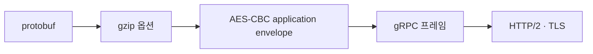

# 원본 Android 기준 분석과 실행 검증

2026-11-11 점검. 원본 동작 → 로컬 연결판 비교 → 필요한 구간의 진단 순서로 검증합니다. 현재 자료에는 **우리 환경에서 원본 Android APK가 공식 서버에 정상 로그인한 뒤 메뉴를 사용하는 통신 캡처가 없습니다.** 진단판의 홈 진입을 그 증거로 대체하지 않습니다.

## 확인한 원본 파일

| 항목 | 값 |
| --- | --- |
| 릴리스 자산 | `725772331`, 원본 6.1.1 XAPK |
| 크기·SHA-256 | 167,699,540바이트 · `ab3bd9186ccc2659f91fcf2a48e25b591e94b4209c505f2ca401be8b22e5de36` |
| 패키지·버전 | `game.qualiarts.idolypride` · 6.1.1 / versionCode 414 |
| CPU·Unity | `arm64-v8a` split · Unity 2022.3.57f1 |
| 원본 서명 인증서 SHA-256 | `06cede031cd36c1986928fb5a9339c859253c07e06aff6137503d8385d3291b5` |

base APK와 ARM64 split의 원본 서명이 일치합니다. 기준 실행에서는 이 두 파일을 `adb install-multiple`로 설치하며 합치기·재서명·패키지명 변경을 하지 않습니다. AES 교체, 스토어 초기화 생략, 강제 사용자 생성 여부 변경, UI observer가 들어간 복사본은 원본 기준 실행에 포함하지 않습니다.

## 통신에서 아는 것과 아직 모르는 것

| 항목 | 확인 수준 |
| --- | --- |
| 공식 API `https://api.game-idolypride.jp`, HTTPS·HTTP/2 gRPC 스택 | 원본 바이너리 정적 분석 |
| 359개 descriptor 파일·68서비스·428 RPC, 요청/응답 타입 | 원본 추출·descriptor pool 검증 |
| protobuf와 AES-CBC·선택적 gzip application envelope | 원본 분석·공개 구현 대조·codec 테스트 |
| 공식 `System.Check`·`Master.Get` 등 익명 조회 | 우리 도구의 실제 공식 서버 호출; 원본 APK 실행 캡처와 구분 |
| 공개 튜토리얼·스토리·레슨 참조 응답 | 외부 공개 공식 캡처를 고정 커밋에서 보존 |
| 원본 APK의 현재 공식 로그인·메뉴별 요청 순서·정상 상태 변경 | **직접 관측 자료 없음** |
| 로컬 연결판·진단판의 홈·레슨·라이브 메뉴 | 별도 로컬 실행 자료; 공식 동작 검증과 구분 |

원본의 전송 계층은 다음과 같습니다. 상세 바이트 형식은 [프로토콜 문서](protocol.md)에 있습니다.

`Auth.Login`에 보내는 Firebase ID token과 응답의 `gameAuthToken`은 다릅니다. 후속 게임 세션 metadata는 `x-auth-token`을 사용합니다. 정적 초기화 호출 순서를 실제 원본의 요청 순서로 확정하지 않습니다. 로컬 HTTP/h2c는 별도 URI 분기와 연결판의 동작이며 원본 공식 HTTPS 통신과 구분합니다.

TLS 패킷을 수집해도 RPC 경로와 본문은 그대로 보이지 않습니다. TLS를 해석한 경우에도 gRPC 프레임을 처리한 뒤 application envelope를 해독해야 protobuf를 읽을 수 있습니다. 원본은 `debuggable=false`이며 manifest의 기본 신뢰는 system CA입니다. 사용자 CA 설치만으로 복호화가 가능하다고 가정하지 않습니다. 네이티브 HTTP handler의 proxy·인증서 처리도 별도 확인 대상입니다.

## 현재 서버 구현 범위

기준 소스 `b18f711`의 기본 처리 경로와 정규화 스키마 지문 `0fcf90596261dcd9bbed165bd93859dc30127e2a494e6529bafbd8885675edf3`를 대조했습니다. 이 수치는 현재 소스 기준이며 배포 APK의 버전별 지원 범위와 구분합니다.

| 분류 | 경로 수 | 의미 |
| --- | ---: | --- |
| 원본 스키마 전체 | 428 | unary 427개 + streaming 1개 |
| 기본 명시 처리 경로 | 52 | 제한된 자체 처리 50개 + 공개 fixture 전용 2개; 고정 기록·로컬 빈 목록 포함 |
| 기본 자체 처리 경로 없음 | 375 unary | 가져온 사용자 fixture가 없는 조건; 공식 기능 구현으로 계산하지 않음 |
| 미지원 streaming | 1 | `Health.Watch` |
| 기본 OFF 실험 | 1 | 첫 메인 퀘스트에 한정된 `Quest.Start`; 일반 라이브 전체 구현 아님 |

427개 unary를 등록했다는 것은 427개 기능이 구현됐다는 뜻이 아닙니다. 52개 경로도 공식 기능 52개를 완전히 재현했다는 뜻이 아닙니다. 전체 요청·응답 타입과 제한은 [RPC 분류 CSV](rpc-coverage-6.1.1.csv)에 기록했습니다. 미지원 경로도 인증 상황에 따라 먼저 `UNAUTHENTICATED` 등으로 중단될 수 있으므로 오류 이름만으로 기능 존재를 판단하지 않습니다.

현재 소스에는 원본 프로필 화면의 계약을 확인한 세 경로도 추가했습니다. `Profile.Top`은 저장된 계층 포인트를 기존 홈과 같은 마스터 규칙으로 읽고, 전역 순위를 뜻하지 않는 순위 0과 현재 로컬의 빈 친구 목록을 반환합니다. 상태·보상은 바꾸지 않습니다. `Profile.UpdateName`은 이름만 원자적으로 저장하고 `commonResponse.updatedData.user`로 반환합니다. 원본 입력 UI의 UTF-16 10단위 제한을 적용하며, 줄바꿈·탭 거부는 로컬 입력 정책입니다. `Profile.UpdateMessage`는 기존 `profile.message`만 원자적으로 저장하고 `commonResponse.updatedData.profile`로 반환합니다. UTF-16 1–60단위·공백만인 입력과 탭 거부를 로컬 정책으로 적용하고, 수락한 CR/LF와 비어 있지 않은 공백·Unicode 정규화는 보존합니다. 공식 금칙어 검사·프로필 미션 진행·보상은 포함하지 않습니다. 세 경로의 인증·스키마·상태 보존과 변경 경로의 영속성은 자동 검증했으며 실제 프로필 UI의 동작은 아직 확인하지 않았습니다.

우선 대조할 미구현 범위는 다음과 같습니다. 이것은 코드·스키마 기반 목록이며 원본에서 실제 호출되는 순서라는 뜻은 아닙니다.

| 범위 | 대표 경로 | 현재 공백 |
| --- | --- | --- |
| 신규 계정 초기화 | `Auth.Create` | 현재 로컬 인증은 `Login`만 처리. bootstrap의 사용자 생성 여부 우회가 원본 흐름의 공백을 숨길 수 있음 |
| 일반 라이브 | `Quest.Start` | 첫 퀘스트 실험 외 전투·정산과 실제 재생 검증 |
| 미션 | `Mission.List` | 목록과 진행·보상 계약 |
| 활동 | `Activity.StartPromotion` | 일반 레슨 이외 활동의 상태 전이 |
| 촬영 | `Photo.CreateShootings` | 생성·소비·결과 계약 |
| 육성 | `Card.LimitBreak`, `Accessory.Enhance` | 초기 카드 강화 이외의 재료 소비·능력치·반환 상태 |
| 선물 | `Gift.Receive` | 현재 빈 목록 조회와 실제 수령 처리의 차이 |
| 가챠·로그인 보너스 | `Gacha.List`, `LoginBonus.List` | 목록·일정·수령과 일일 상태 계약 |

이 목록을 빈 성공 응답으로 채우지 않습니다. 원본의 요청·응답과 전후 상태, 마스터 참조·오류 조건을 확인한 뒤 저장·재시도·보상 중복 방지를 구현합니다. 기존 지원 범위는 [게임 상태 문서](gameplay-status.md)를 따릅니다.

## 에뮬레이터 선정과 원본 기준 실행 결과

선정 기준은 **Google 공식 Android Emulator·공식 시스템 이미지·실제 가속 확인·원본 게임 구동**입니다. ARM64 호스트에서는 ARM64 이미지를 사용합니다. x86_64 호스트에서는 공식 x86_64 이미지의 Google 제공 ARM64 앱 번역 지원을 확인해야 하며, ARM64 시스템 이미지를 x86에서 가속할 수 있다고 가정하지 않습니다. 임의 native bridge나 AES·Go 런타임 패치를 추가해 기준 실행으로 취급하지 않습니다.

- [Google: CPU·GPU 가속과 지원 아키텍처](https://developer.android.com/studio/run/emulator-acceleration)
- [Google: ARM 앱 번역 지원](https://android-developers.googleblog.com/2020/03/run-arm-apps-on-android-emulator.html)
- [Google: AVD·Google Play 이미지와 root 제한](https://developer.android.com/studio/run/managing-avds)

현재 선택된 클라우드 컨테이너에는 CPU 가상화 플래그·KVM 장치·GPU 장치가 없습니다. 사용자가 소프트웨어 렌더링·가속 없는 실행도 허용했으므로 GPU 호스트 확보를 작업 재개의 전제 조건으로 삼지 않습니다. 별도의 GitHub Linux 실행에서는 KVM 사용 가능 여부를 실제 확인하고 Google 공식 Google Play API 35 x86_64 이미지와 SwiftShader를 사용했습니다. 이미지의 ABI 목록은 `x86_64,arm64-v8a`이며 ARM64 원본은 Google 제공 `libndk_translation.so`로 실행했습니다. 임의 번역 라이브러리를 추가하지 않았습니다.

| 원본 기준 실행 | 확인한 결과 |
| --- | --- |
| [GitHub 실행 `42858431492`](https://github.com/tagundo/IdolyPride_client/actions/runs/42858431492), 소스 `465c14b` | 원본 해시·서명을 보존한 base·ARM64 split 설치 성공; 게임 PID 관측 |
| 화면 | 모든 수집 화면이 Android의 `Viewing full screen` 안내에 가려짐; 게임 타이틀·홈 화면 관측 없음 |
| 프로세스 | 120초 표본까지 생존, 실행 약 160초에 네이티브 `SIGSEGV`, 180초 표본에서 종료 |
| 크래시 기록 | ARM64 guest backtrace에 `libndk_translation.so`와 `libunity.so`가 함께 나타남; 이 기록만으로 근본 원인을 확정하지 않음 |
| 네트워크 | 새 에뮬레이터 전체의 패킷 메타데이터만 수집; 게임 전용 트래픽·RPC 경로·복호화 본문·공식 로그인 성공의 증거 아님 |

후속 [실행 `42861039882`](https://github.com/tagundo/IdolyPride_client/actions/runs/42861039882), 소스 `09e8f9a`에서는 관측한 Android 전체 화면 안내의 일반적인 `Got It` 버튼을 닫았고 안내가 사라진 것을 확인했습니다. 게임 PID `3865`는 180초까지 살아 있었지만, 30–180초 수집 화면에는 회색 게임 화면 위로 `Pixel Launcher isn't responding` 대화상자가 나타났습니다. Unity 초기화 로그·타이틀·홈 화면은 관측하지 못했습니다. 프로세스 생존을 정상 게임 실행이나 이전 크래시 해결의 증거로 취급하지 않습니다. 게임·계정 UI에는 입력하지 않았습니다.

공식 API 36 이미지의 세 번째 [실행 `42862969552`](https://github.com/tagundo/IdolyPride_client/actions/runs/42862969552), 소스 `34ca8d5`도 정상 구동하지 못했습니다. 180초 화면에는 회색 Surface 위로 `System UI isn't responding`과 전체화면 안내가 겹쳤습니다. API 36의 안내 소유자·resource ID가 `com.android.systemui`로 바뀌어 API 35 전용 입력 검사는 입력하지 않았습니다. PID 생존과 빈 crash buffer를 게임 초기화 성공으로 계산하지 않습니다.

일반 연결판의 [실행 `42863334749`](https://github.com/tagundo/IdolyPride_client/actions/runs/42863334749), 소스 `b18f711`에서는 공개된 APK의 해시·서명을 보존하고 현재 서버 코어를 호스트에서 실행했습니다. 서버 시작·종료와 `adb reverse`는 정상이나 게임 RPC 0건·파일 전송 0바이트였습니다. 게임은 약 122초에 `SIGSEGV`로 종료됐습니다. 따라서 이 실행에서 미구현 메뉴 호출을 직접 관측한 것은 아닙니다. 현재까지 원본의 공식 로그인 후 RPC 캡처도 확보하지 못했습니다.

루팅·시스템 CA·관측 도구를 추가한 조건은 별도로 기록합니다. Google Play 이미지와 root 가능한 이미지의 차이도 구분합니다. 계정·세션 원문은 비공개 로컬 자료로 유지하며 채팅·공개 저장소에 넣지 않습니다.

기존 소프트웨어 GPU·변형 APK 게임 workflow는 기본 비활성화했습니다. 자료와 합성 네이티브 검사는 보존하지만 원본 게임의 정상 동작이나 새 호스트의 적합성 근거로 사용하지 않습니다.
